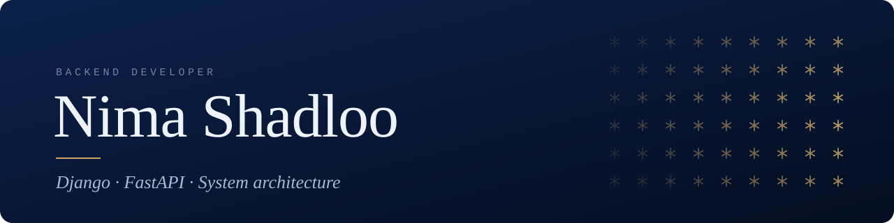

Backend developer working with Django and FastAPI. Co-founder of **Orviniq**, where I lead product and system architecture. B.Sc. Computer Engineering student at the University of Guilan.

### Selected work

Agent Skills that help AI coding tools follow production-grade Django practice.

- **[secure-code-auditor](https://github.com/n-shadloo/secure-code-auditor)** — security review for Django and DRF code
- **[git-authoring](https://github.com/n-shadloo/git-authoring)** — commit messages, pull requests, and release notes from your changes
- **[frontend-production-engineer](https://github.com/n-shadloo/frontend-production-engineer)** — Next.js and TypeScript frontends on a Django backend

### Stack

  
  
  
  
  

  
  
  

  
  
  
  
  

### Activity

  
  

### Contact

  
  
  
  

